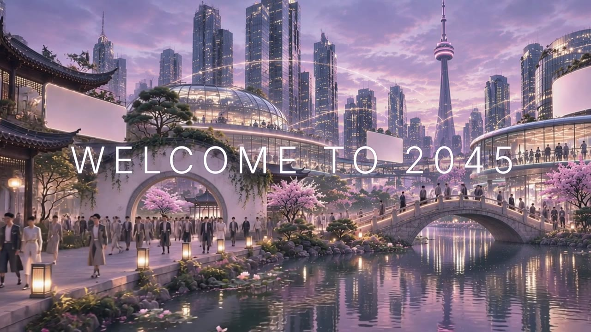
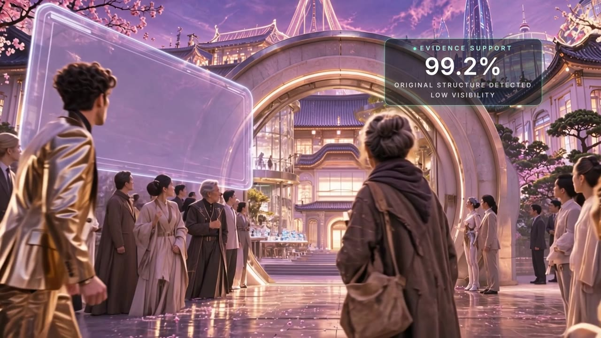
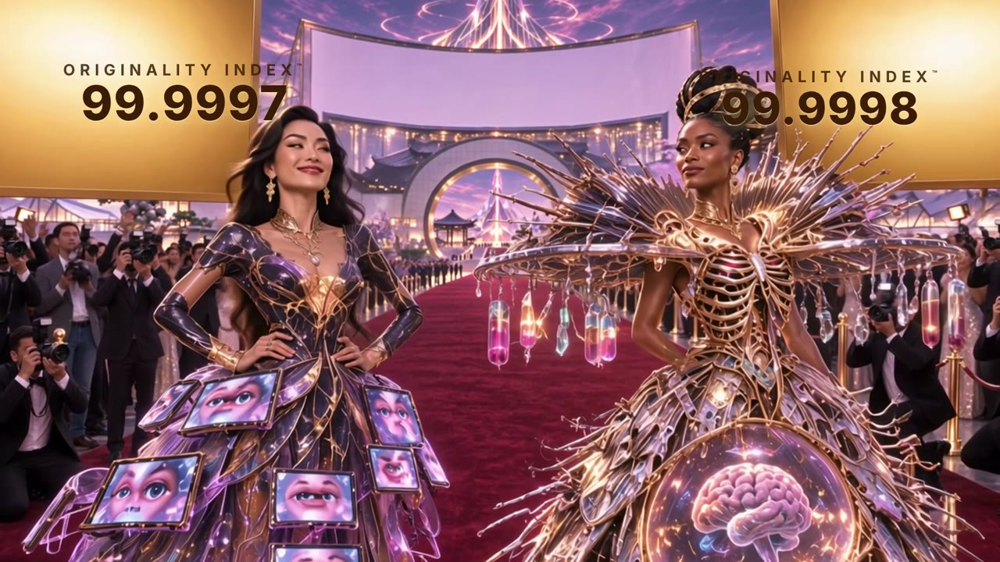
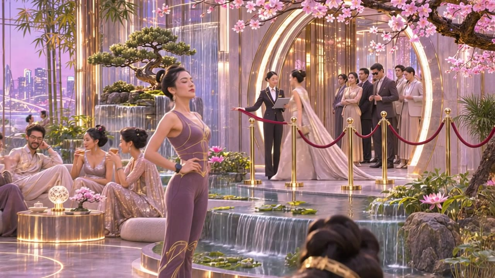
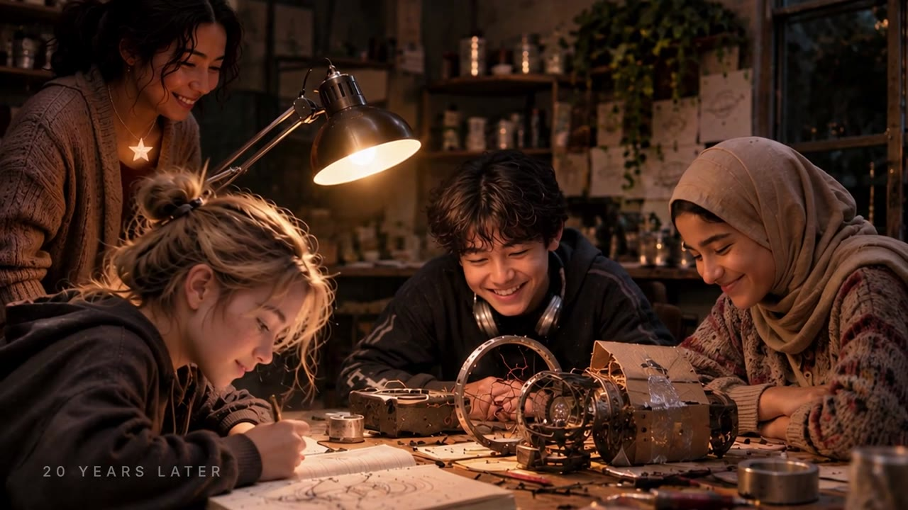

# WELCOME TO 2045
*A Generative AI Speculative Short Film · 6:29*

▶ **Watch on YouTube:** https://youtu.be/3zDMtAxpG4U

## About
WELCOME TO 2045 is an independent speculative short film by Suning Gu, exploring a future where truth, provenance, and even inner feeling states become easier to see.

But humans are still human.

As this happens, society begins turning truth into scores, rankings, identities, and new forms of status. Even when public ranking is removed, competition quietly returns through "unranked" prestige, effortless living, and carefully engineered natural development.

At the center of the film is a question:

> When truth becomes easier to see, will we use it to meet the world more deeply — or turn it into scores that make us feel real?

| | |
|---|---|
|  |  |
|  |  |

## How it was made
Concept, world, story, and editorial decisions: Suning Gu.

Visualized with generative AI:
- Images: ChatGPT
- Video: Kling · Google Flow
- Voice: ElevenLabs
- Music: Suno
- Script & prompts: ChatGPT · Claude
- Graphics & edit: Claude · CapCut

## Related Work
This film connects to broader questions in my research and technical work concerning feeling, truth, provenance, subjectivity, and the relationship between computational systems and human experience.

- [Feeling State Framework (FSF)](https://github.com/celeste1-ops/FSF)
- [Research History](https://github.com/celeste1-ops/research-provenance-platform)

---
© 2026 Suning Gu. All rights reserved.
